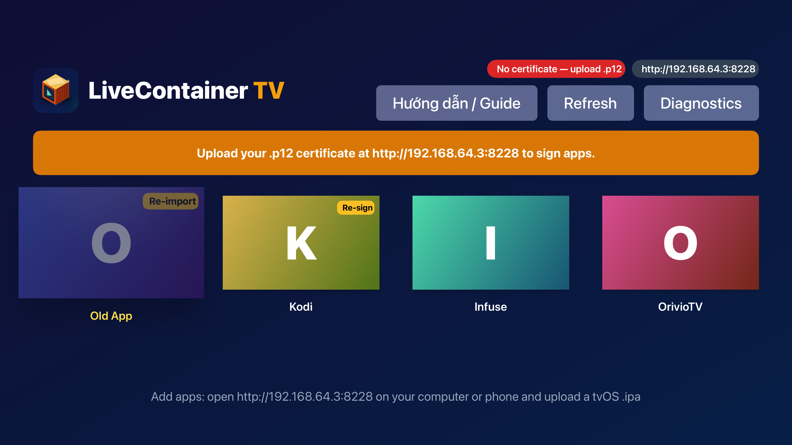
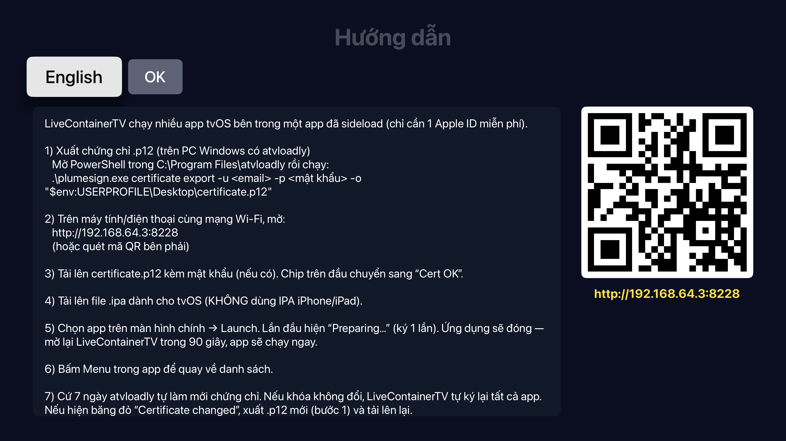
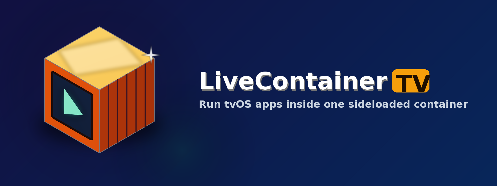

# LiveContainerTV

<p align="center"></p>

**Tiếng Việt** | [English](#english)

LiveContainerTV là app tvOS cho phép chạy **nhiều app tvOS bên trong một app đã sideload** — chỉ cần **Apple ID miễn phí**. Bạn cài LiveContainerTV một lần bằng atvloadly, rồi tải thêm app (.ipa tvOS) qua trình duyệt.





## Cần chuẩn bị
- Apple TV chạy **tvOS 17 trở lên**
- PC Windows có **atvloadly 0.8.0-1-win**: <https://github.com/hongson117/atvloadly-windows/releases>
- Một **Apple ID miễn phí**
- Máy tính/điện thoại **cùng mạng Wi-Fi** với Apple TV

## Các bước
1. **Cài atvloadly** từ link trên, mở ứng dụng.
2. **Ghép đôi Apple TV**: trên Apple TV vào *Cài đặt → Điều khiển từ xa và thiết bị → Ứng dụng và thiết bị từ xa*; trong atvloadly chọn Apple TV và nhập mã hiện trên TV.
3. **Tải `LiveContainerTV.ipa`** ở mục [Releases](../../releases) của repo này.
4. **Sideload**: trong atvloadly chọn file IPA, đăng nhập Apple ID, bấm cài.
5. **Xuất chứng chỉ .p12**: mở PowerShell trong `C:\Program Files\atvloadly` và chạy
   ```powershell
   .\plumesign.exe certificate export -u <email> -p <mật khẩu> -o "$env:USERPROFILE\Desktop\certificate.p12"
   ```
6. Mở LiveContainerTV trên TV. Màn hình **Hướng dẫn / Guide** hiện địa chỉ và mã QR, ví dụ `http://192.168.1.20:8228`. Mở địa chỉ đó trên máy tính/điện thoại.
7. **Tải lên `certificate.p12`** (kèm mật khẩu nếu có). Chip trên TV chuyển “Cert OK”.
8. **Tải lên IPA tvOS** (không dùng IPA iPhone/iPad).
9. **Chạy app**: chọn ô app → *Launch*. Lần đầu sẽ hiện *Preparing…* (ký một lần). LiveContainerTV sẽ đóng — **mở lại trong 90 giây** để app chạy (tvOS không cho app tự khởi động lại).
10. Bấm **Menu** trong app để quay về danh sách.

## Làm mới 7 ngày & tự ký lại
Với Apple ID miễn phí, atvloadly làm mới chứng chỉ mỗi 7 ngày. Khi mở lại, LiveContainerTV kiểm tra chứng chỉ:
- Khóa không đổi → **tự ký lại tất cả app**, không cần làm gì.
- Khóa đổi → băng đỏ **“Certificate changed”**: xuất .p12 mới (bước 5) và tải lên; app sẽ được ký lại tự động.

## Xử lý lỗi
| Lỗi | Cách xử lý |
|---|---|
| `-80045` khi cài | Cập nhật atvloadly bản mới nhất |
| `Info.plist not found` | IPA sai hoặc không phải tvOS |
| `Library not loaded` | Bấm *Re-sign* app đó hoặc tải lại IPA |
| Băng “Certificate changed” | Xuất .p12 mới và tải lên |
| Ô **Re-import** | tvOS đã xoá file để giải phóng bộ nhớ — tải lại IPA |
| `ERR_EMPTY_RESPONSE` trên web | Để LiveContainerTV mở ở màn hình chính, cùng Wi-Fi, thử lại |

Thông tin kỹ thuật (fingerprint, thời gian khởi động, log): nút **Diagnostics**.

---

## Ủng hộ

Nếu LiveContainerTV hữu ích, bạn có thể ủng hộ tác giả qua MoMo / chuyển khoản VietQR. Cảm ơn bạn! (Trong app: nút **Ủng hộ / Support** trên màn hình chính.)


## English
LiveContainerTV lets you run **several tvOS apps inside one sideloaded app** using a **free Apple ID**. Install it once with atvloadly, then add tvOS .ipa files from a browser.

**Requirements:** Apple TV on tvOS 17+, a Windows PC with [atvloadly 0.8.0-1-win](https://github.com/hongson117/atvloadly-windows/releases), a free Apple ID, same Wi-Fi network.

**Steps**
1. Install atvloadly and pair your Apple TV (*Settings → Remotes and Devices → Remote App and Devices*).
2. Download `LiveContainerTV.ipa` from [Releases](../../releases) and sideload it with atvloadly.
3. Export your certificate in PowerShell from `C:\Program Files\atvloadly`:
   ```powershell
   .\plumesign.exe certificate export -u <email> -p <password> -o "$env:USERPROFILE\Desktop\certificate.p12"
   ```
4. Open LiveContainerTV; the **Guide** screen shows `http://<tv-ip>:8228` plus a QR code. Open it on your computer/phone.
5. Upload `certificate.p12` (with password), then upload a **tvOS** IPA (not iPhone).
6. Select the app → *Launch*. First time: *Preparing…* (one-time signing). The app closes — reopen it within 90 s and the guest starts.
7. Press **Menu** in the guest to return to the list.

**7-day refresh:** when atvloadly refreshes the certificate, LiveContainerTV re-signs all apps automatically if the key is unchanged; otherwise a *Certificate changed* banner asks for a new .p12.

**Troubleshooting:** `-80045` → update atvloadly · `Info.plist not found` → not a tvOS IPA · `Library not loaded` → Re-sign / re-upload · *Re-import* tile → tvOS purged files, upload again · `ERR_EMPTY_RESPONSE` → keep the app open on its home screen, same Wi-Fi.

| Icon | Top Shelf |
|---|---|
|  |  |

## Donate

If LiveContainerTV is useful to you, you can support the author via MoMo / VietQR bank transfer. Thank you! (In the app: the **Ủng hộ / Support** button on the home screen.)


